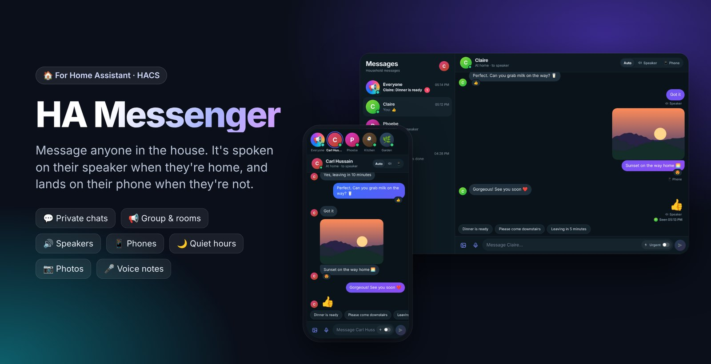
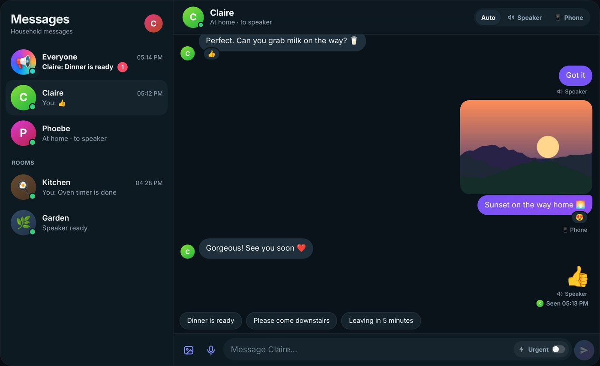
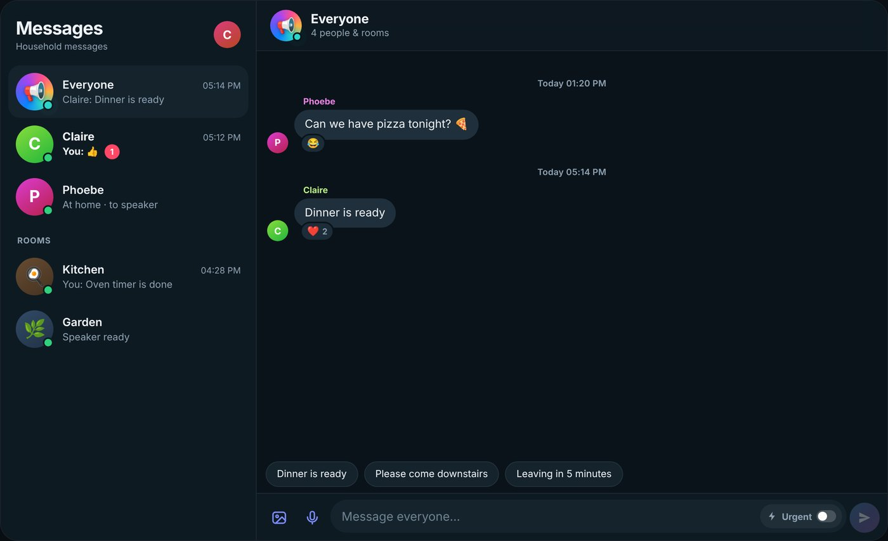
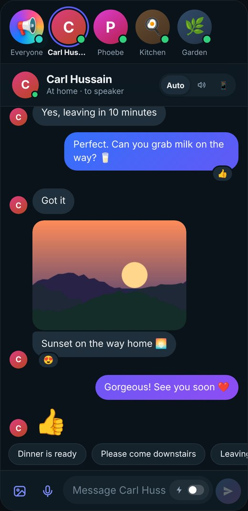
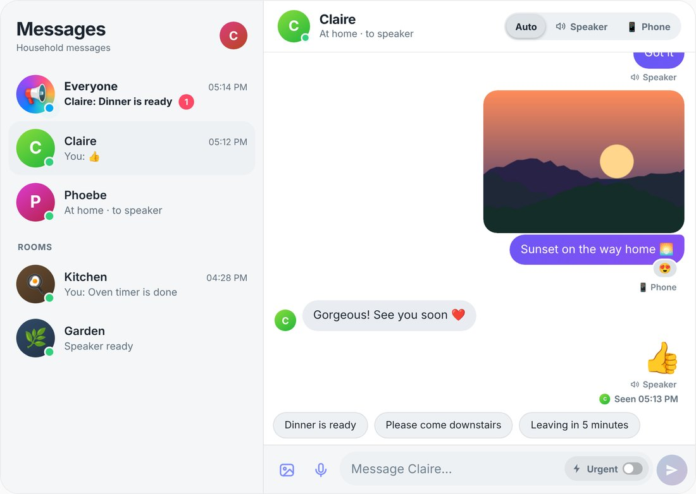

# HA Messenger



[](https://hacs.xyz/docs/faq/custom_repositories)
[](https://github.com/carlosamus123/HA-Messenger/releases/latest)
[](https://github.com/carlosamus123/HA-Messenger/actions/workflows/validate.yml)
[](https://ko-fi.com/northstarcreations)

**A household messenger for Home Assistant.** Send a message to someone and it's read out on their speaker when they're home, or pops up on their phone when they're out. It's all one card: no scripts, automations or helpers to build.

## ✨ Features

| Feature | What it does |
|---|---|
| 💬 **Private chats** | Two-way chats between everyone in the house. Each person uses their own Home Assistant login, so the card knows who's talking. |
| 🔊📱 **Speaker or phone, automatically** | Spoken on their speaker when they're home, a phone notification when they're out. Or pin it to one with a tap. |
| 📢 **Group chat & rooms** | Message every speaker and phone at once, or a single room like the Kitchen. |
| 🌙 **Quiet hours** | Speakers chime instead of talking (with Chime TTS), or stay silent and ping phones. **⚡ Urgent** gets through anyway. |
| 📷 **Photos & 🎤 voice notes** | Paste, drag or pick photos (they're sent to phones too). Record voice notes right in the card. |
| ❤️ **Reactions, read receipts & unread badges** | All the little touches you'd expect from a messaging app. |
| 🎛️ **Full visual editor** | Pick people, speakers, phones and rooms from dropdowns. "Add all people" matches phones for you. No YAML. |
| 🌗 **Looks at home anywhere** | Wall tablets, phones and desktop. Dark messenger style, or follow your Home Assistant theme. |

## 📸 Screenshots

**Private chat:** messages show where they went (speaker or phone), with reactions and "Seen".



**Group chat:** one message to every speaker and phone in the house.



| On a phone | Following your HA theme |
|:---:|:---:|
|  |  |

## 🧰 What you need

| | |
|---|---|
| Home Assistant | 2024.6 or newer |
| A **Local To-do** list | Where messages are stored. Settings → Devices & services → Add integration → **Local To-do**, call it “Messenger”. |
| A text-to-speech service | Any one: Google Translate, Piper, Home Assistant Cloud, etc. Only needed for speakers. |
| Companion app (optional) | For phone notifications. |
| Chime TTS (optional) | For a chime before messages, and chime-only quiet hours. Used automatically if installed. |

## 📦 Install

### HACS (recommended)

1. HACS → ⋮ → **Custom repositories** → add `https://github.com/carlosamus123/HA-Messenger` as type **Dashboard**.
2. Search for **HA Messenger** and download it.
3. Reload your browser.

[](https://my.home-assistant.io/redirect/hacs_repository/?owner=carlosamus123&repository=HA-Messenger&category=plugin)

### Manual

Download `ha-messenger-card.js` from the [latest release](https://github.com/carlosamus123/HA-Messenger/releases/latest), copy it to `/config/www/`, then add `/local/ha-messenger-card.js` as a JavaScript module under Settings → Dashboards → ⋮ → Resources.

## 🚀 Set up

1. Create the **Local To-do** list (see above).
2. Edit a dashboard → **Add card** → **HA Messenger**.
3. In **General**, pick your to-do list under *Storage*.
4. In **People**, press **Add all people**. Phones are matched from each person's companion app automatically; add each person's speaker.
5. Optionally add **Rooms**, choose a voice, and turn on **Quiet hours**.

The card works best in a **Panel** view or as a full-width card. Set *Open this page from phone notifications* to that view's path (for example `/lovelace/messages`) so tapping a notification opens the chat.

## 📝 YAML reference

Everything in the visual editor can also be written by hand:

```yaml
type: custom:ha-messenger-card
title: Messages
storage_entity: todo.messenger        # required: a Local To-do list
appearance: dark                       # dark | theme
open_path: /lovelace/messages
people:
  - person: person.carl
    speaker: media_player.office       # optional
    notify: mobile_app_carls_phone     # optional: notify action without "notify."
    phone_tts: false                   # Android only: read aloud on the phone
    quiet_hours: true
    in_broadcast: true
    broadcast_to: auto                 # auto | speaker | phone | both
  - person: person.claire
    notify: mobile_app_claires_phone
rooms:
  - name: Kitchen
    icon: "🍳"                        # emoji or mdi:icon
    speaker: media_player.kitchen
broadcast:
  enabled: true
  name: Everyone
  icon: "📢"
tts:
  engine: tts.google_translate_en_com  # empty = first TTS service found
  language: en-GB
  voice: ""
  prefix_sender: true                  # "Carl says, …"
  chime_tts: auto                      # auto | off
  chime: bells
quiet_hours:
  enabled: true
  start: "22:00"
  end: "07:00"
  days: [1, 2, 3, 4, 5, 6, 7]          # Mon = 1
features:
  photos: true
  voice_notes: true
  reactions: true
  read_receipts: true
  urgent: true
quick_messages: [Dinner is ready, Please come downstairs]
emojis: ["❤️", "😂", "😮", "😢", "👍", "🎉"]
max_messages: 300                      # shown in the card
retention_days: 90                     # older messages are deleted; 0 = keep forever
```

## 💡 Good to know

- **Privacy.** Messages are stored as items in your to-do list. Anyone with a Home Assistant login can open that list and read them, so this is a family messenger, not a secret one. Photos are served from Home Assistant's image store using links that can't be guessed.
- **Voice notes need an admin account.** Home Assistant only lets admins upload media, so the microphone button is hidden for other users. Notes are saved in your local media folder.
- **Who is "me"?** The card matches your login to a Person (Settings → People → each person's *user*). If your login isn't linked to a person, you can still post to the group and rooms.
- **iPhone vs Android.** Notifications work on both. *Speak aloud on phone* is Android only; urgent messages use high priority on Android and time-sensitive alerts on iPhone.
- **The to-do list.** Each message shows up there with a readable title (e.g. "Carl → Claire: Dinner is ready"). You can hide the list from the sidebar if you like. Don't rename item descriptions; that's where the message data lives.

## 🛠️ Development

```bash
npm run build   # src/ → dist/ha-messenger-card.js
npm test        # build + browser tests (needs Playwright)
```

Source lives in `src/` (`util.js`, `card.js`, `editor.js`, `styles.css`). Commit the rebuilt `dist/` file with your change. To release, bump `version` in `package.json`, rebuild, and push to `main`; the workflow tags it and publishes the GitHub release with the card attached.

## ☕ Support

If HA Messenger is useful in your home, a coffee keeps it going:

[](https://ko-fi.com/northstarcreations)

Found a bug or have an idea? [Open an issue](https://github.com/carlosamus123/HA-Messenger/issues).

## 📄 License

MIT
